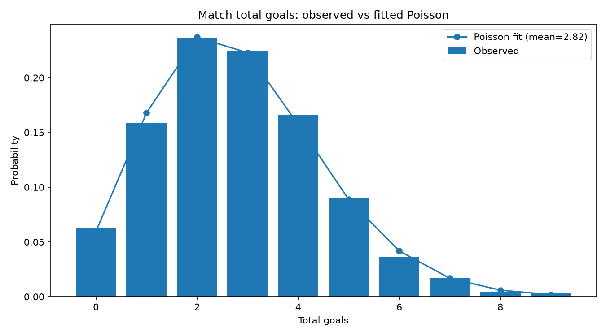
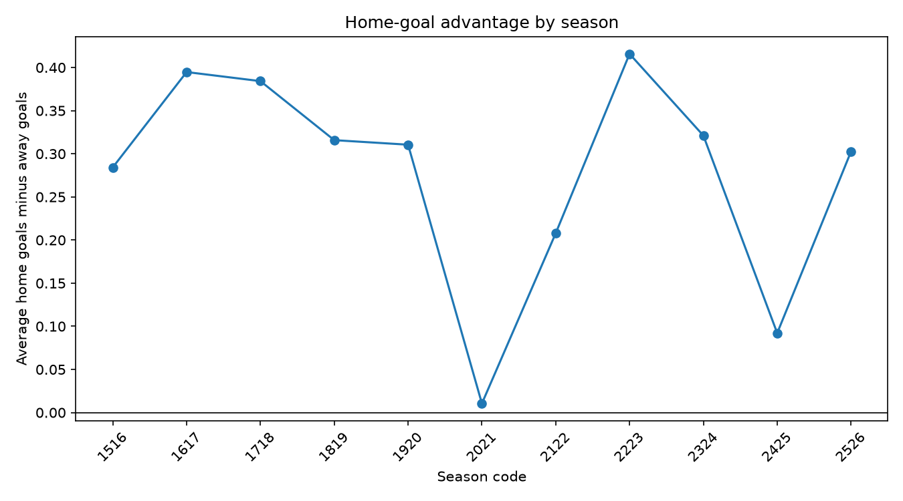

# Exploratory data analysis

## Dataset

- Matches: 4180
- Date range: 2015-08-08 to 2026-05-24
- Seasons: 11
- Total goals per match: mean 2.823

## Full-time outcomes

| Outcome | Percentage |
|---|---:|
| Home win | 44.33% |
| Draw | 23.68% |
| Away win | 31.99% |

## Average goals per team appearance

| Team | Scored | Conceded |
|---|---:|---:|
| Arsenal | 1.866 | 1.077 |
| Aston Villa | 1.368 | 1.480 |
| Bournemouth | 1.310 | 1.661 |
| Brentford | 1.489 | 1.453 |
| Brighton | 1.272 | 1.398 |
| Burnley | 1.016 | 1.556 |
| Cardiff | 0.895 | 1.816 |
| Chelsea | 1.696 | 1.175 |
| Crystal Palace | 1.187 | 1.419 |
| Everton | 1.234 | 1.376 |
| Fulham | 1.193 | 1.548 |
| Huddersfield | 0.658 | 1.763 |
| Hull | 0.974 | 2.105 |
| Ipswich | 0.947 | 2.158 |
| Leeds | 1.322 | 1.757 |
| Leicester | 1.474 | 1.477 |
| Liverpool | 2.084 | 1.041 |
| Luton | 1.368 | 2.237 |
| Man City | 2.333 | 0.883 |
| Man United | 1.579 | 1.167 |
| Middlesbrough | 0.711 | 1.395 |
| Newcastle | 1.387 | 1.418 |
| Norwich | 0.772 | 1.982 |
| Nottingham Forest | 1.270 | 1.526 |
| Sheffield United | 0.825 | 1.807 |
| Southampton | 1.126 | 1.649 |
| Stoke | 1.026 | 1.570 |
| Sunderland | 1.044 | 1.570 |
| Swansea | 1.009 | 1.561 |
| Tottenham | 1.794 | 1.230 |
| Watford | 1.079 | 1.675 |
| West Brom | 0.941 | 1.520 |
| West Ham | 1.380 | 1.565 |
| Wolves | 1.099 | 1.451 |

## Match total-goals distribution

The Poisson comparison is fitted using the observed mean total goals (2.823).

| Total goals | Observed probability | Poisson probability |
|---:|---:|---:|
| 0 | 0.0629 | 0.0594 |
| 1 | 0.1584 | 0.1678 |
| 2 | 0.2361 | 0.2368 |
| 3 | 0.2249 | 0.2228 |
| 4 | 0.1663 | 0.1572 |
| 5 | 0.0907 | 0.0888 |
| 6 | 0.0366 | 0.0418 |
| 7 | 0.0170 | 0.0168 |
| 8 | 0.0041 | 0.0059 |
| 9 | 0.0031 | 0.0019 |
| 10 | 0.0000 | 0.0005 |

## Home advantage by season

Home advantage is average home goals minus average away goals; positive values mean more home goals.

| Season | Home goals | Away goals | Home advantage |
|---|---:|---:|---:|
| 1516 | 1.492 | 1.208 | 0.284 |
| 1617 | 1.597 | 1.203 | 0.395 |
| 1718 | 1.532 | 1.147 | 0.384 |
| 1819 | 1.568 | 1.253 | 0.316 |
| 1920 | 1.516 | 1.205 | 0.311 |
| 2021 | 1.353 | 1.342 | 0.011 |
| 2122 | 1.513 | 1.305 | 0.208 |
| 2223 | 1.634 | 1.218 | 0.416 |
| 2324 | 1.800 | 1.479 | 0.321 |
| 2425 | 1.513 | 1.421 | 0.092 |
| 2526 | 1.526 | 1.224 | 0.303 |

